# 🎬 PersonaCut

**Seu perfil cinéfilo em 8 eixos — com quatro leituras em linguagem clara, arquétipo, espelhos no catálogo, retrato escrito por IA e um card 9:16 para os stories.**

<p>


</p>

| Início | Card de story (1080 × 1920) |
| --- | --- |
|  | 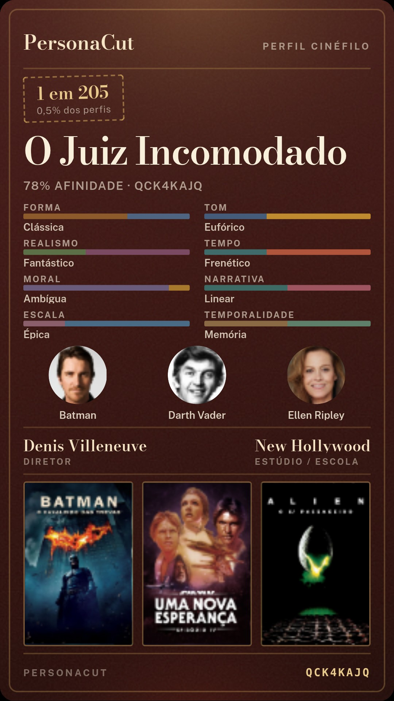 |

---

## Sumário

- [O que é](#o-que-é)
- [Prints](#prints)
- [Stack](#stack)
- [Como executar](#como-executar)
- [Deploy no InfinityFree](#deploy-no-infinityfree-sem-docker)
- [Os 8 eixos](#os-8-eixos)
- [Três modos de teste](#três-modos-de-teste)
- [Como o perfil é calculado](#como-o-perfil-é-calculado)
- [O que o resultado entrega](#o-que-o-resultado-entrega)
- [Retrato por IA (Groq)](#retrato-por-ia-groq)
- [TMDB e cenas do quiz](#tmdb-e-cenas-do-quiz)
- [Estrutura do projeto](#estrutura-do-projeto)
- [Banco de dados](#banco-de-dados)
- [Testes](#testes)
- [Roadmap](#roadmap)
- [Créditos](#créditos)

## O que é

PersonaCut é uma aplicação web de análise de personalidade cinematográfica. Você
responde a afirmações de gosto (Likert de 5 pontos) e o sistema posiciona o seu
perfil em **oito eixos bipolares** — imagem, emoção, mundo, ritmo, ética, história,
tamanho e época. A partir desse vetor, ele traduz o conjunto em **quatro leituras
em linguagem clara** (o que você procura, o que te afasta e dois filmes), busca no
catálogo os personagens, o diretor e o estúdio mais próximos e redige um retrato.

- **100% em pt-BR**, interface em "cinema analógico": papel envelhecido, vinho de
  cartaz, dourado de letreiro, Bodoni Moda para display e Public Sans para texto.
- **Sem cadastro**: o resultado é acessível por um código público de 8 caracteres.
- **Determinístico**: arquétipo, afinidade e raridade nunca dependem de IA — o
  modelo de linguagem só acrescenta redação.
- **Projeto da disciplina de Desenvolvimento Web 2 (DW2)**.

## Prints

| Início | Os 8 eixos |
| --- | --- |
|  | 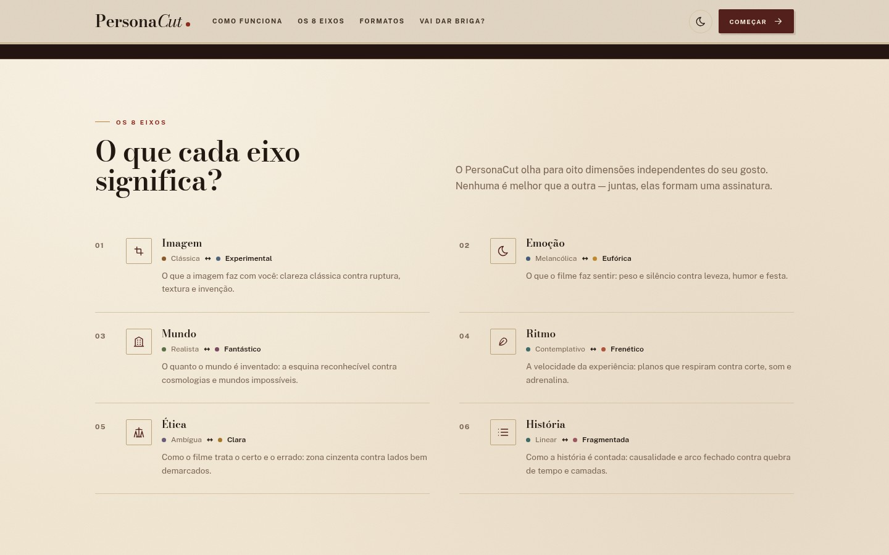 |

| Três formatos | Quiz com cena do filme |
| --- | --- |
| 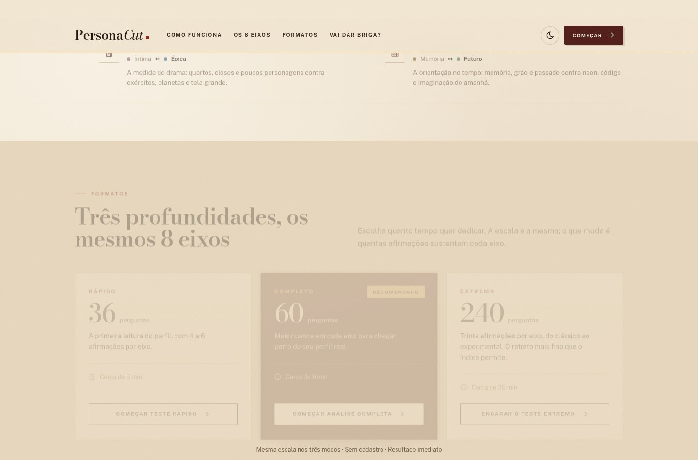 | 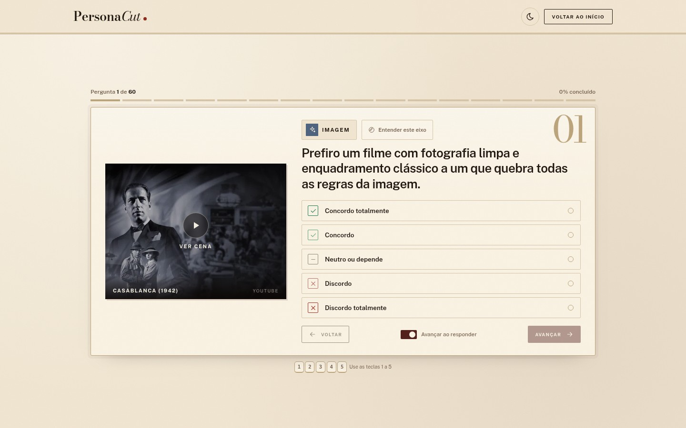 |

| Resultado | Além do espelho |
| --- | --- |
| 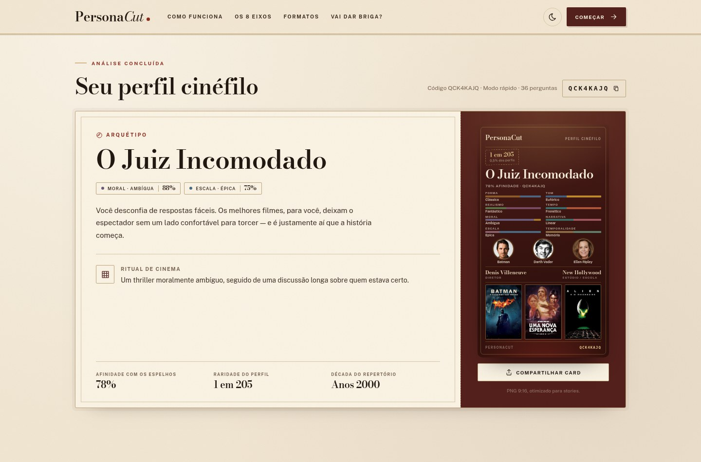 | 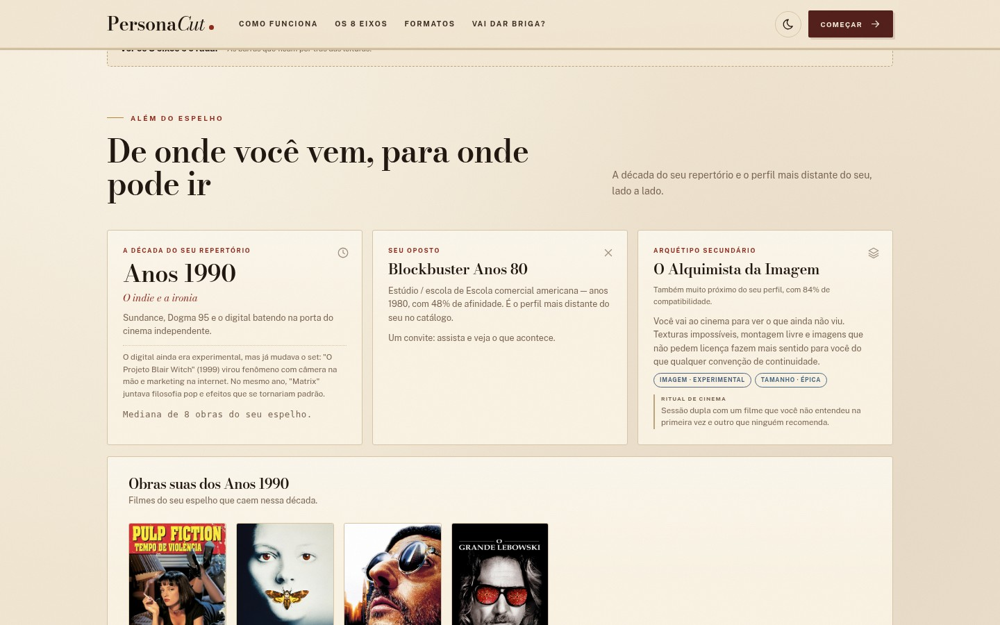 |

| A crítica do perfil | Card 9:16 exportado |
| --- | --- |
| 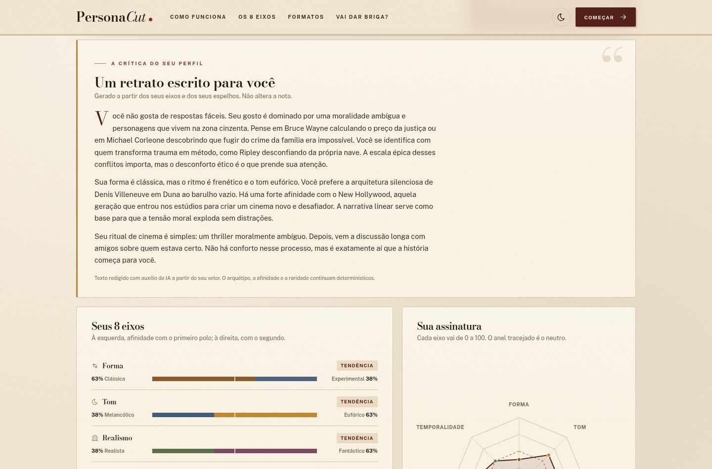 |  |

| Card no celular | Tema escuro |
| --- | --- |
| 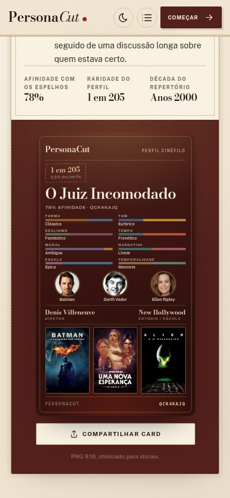 | 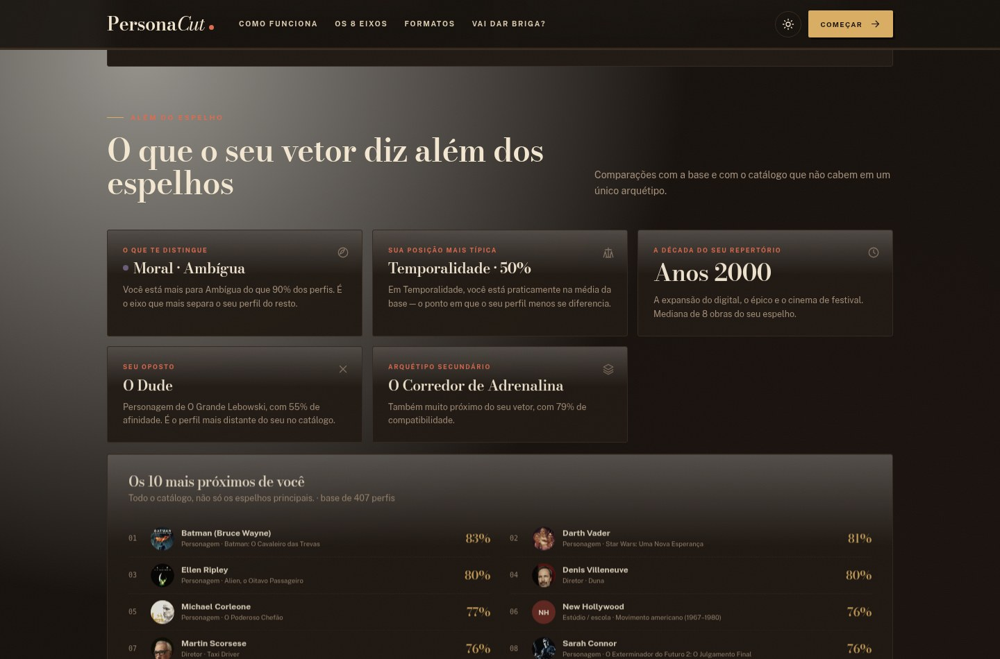 |

| Modo Sinergia | Ficha rápida (TMDB) |
| --- | --- |
| 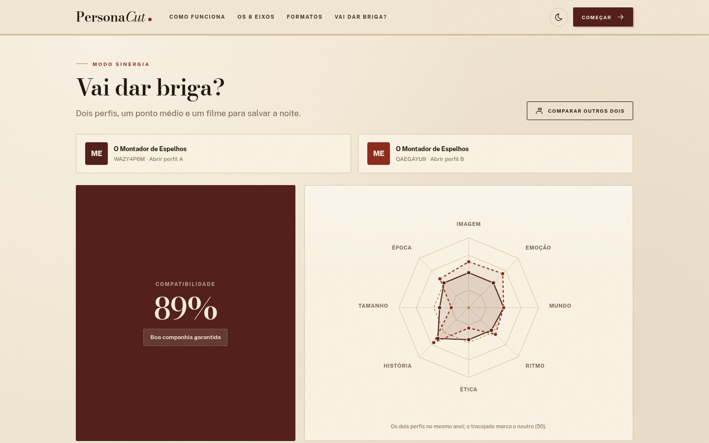 |  |

| Painel admin | Perguntas (240 no pool) |
| --- | --- |
| 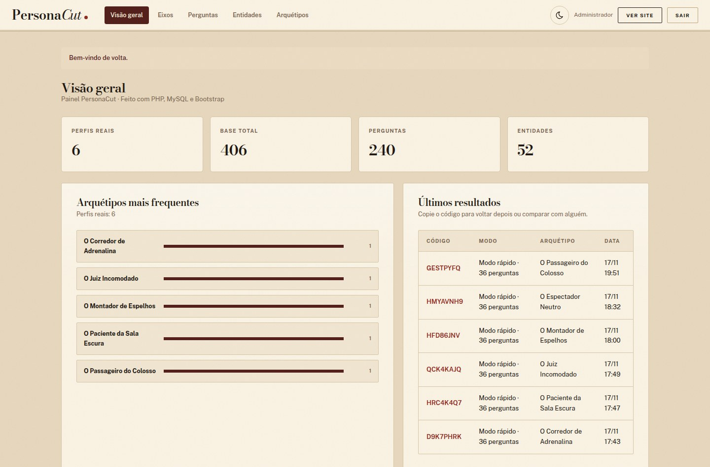 | 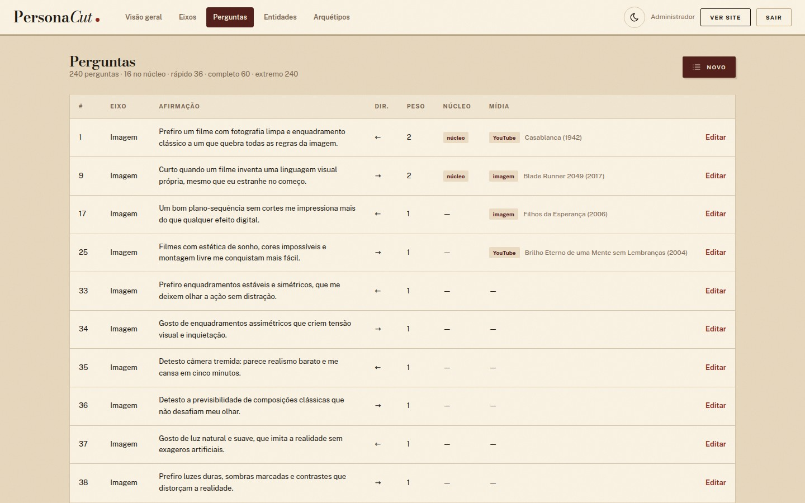 |

## Stack

| Camada | Tecnologia |
| --- | --- |
| Back-end | PHP 8.2 puro (POO, PSR-12, PDO com prepared statements) |
| Banco | MySQL 8.4 (`utf8mb4`) |
| Front-end | Bootstrap 5 (via Vuexy) + CSS customizado + JS ES6 (Fetch API) |
| Gráficos | Radar bipolar em **SVG próprio** (sem biblioteca) |
| Captura do card | `html2canvas` (vendorizado) + Web Share API |
| IA | Groq (chat completion) — só para o retrato do perfil |
| Ambiente | Docker + Docker Compose (Apache, MySQL e phpMyAdmin) |

O design system fica em `public/assets/css/personacut.css`, com tokens de cor,
tipografia didone, grão de filme, vinheta e tema escuro.

## Como executar

Requisitos: Docker com Docker Compose.

```bash
cp .env.example .env
docker compose up -d --build
```

O banco é criado e populado na primeira subida (schema + seed + enriquecimento
versionado). Se você já tinha um volume antigo, rode `docker compose down -v`
antes.

| Serviço | Endereço |
| --- | --- |
| Aplicação | http://localhost:8090 |
| Painel administrativo | http://localhost:8090/admin/ |
| phpMyAdmin | http://localhost:8091 |
| MySQL | `localhost:3308` |

Credenciais padrão:

| Acesso | Valor |
| --- | --- |
| Banco | `personacut` / `personacut123` / database `personacut` |
| Admin | `admin` / `admin123` |

Chaves opcionais no `.env` (o site funciona sem elas, com fallbacks):

```bash
# Retrato redigido por IA
GROQ_API_KEY=
GROQ_MODEL=                      # padrão: qwen/qwen3.8-27b
GROQ_TRANSCRIPTION_MODEL=whisper-large-v3-turbo

# Catálogo (pôsteres, retratos, logotipos e cenas)
TMDB_API_KEY=
```

**Testes dos serviços** (não precisam de banco):

```bash
docker compose exec app php tests/run.php
```

**Parar os serviços**

```bash
docker compose down      # mantém o banco
docker compose down -v   # apaga o banco
```

## Deploy no InfinityFree (sem Docker)

O pacote `deploy/infinityfree/` tem o necessário para subir em hospedagem
compartilhada (PHP + MariaDB), sem Docker:

- `personacut.sql` — banco completo, já com `utf8mb4_unicode_ci` (MariaDB);
- `htdocs/.htaccess` — encaminha a raiz para `public/` e bloqueia `src/`,
  `config/`, `storage/`, `sql/` e dotfiles;
- `config/env.example.php` — modelo do `config/env.php` (o `.env` do Docker não
  é lido pelo PHP);
- `README.md` — passo a passo de banco, upload, permissões e teste.

O site precisa ficar na raiz do domínio/subdomínio, porque o app usa URLs
absolutas (`/quiz.php`, `/assets/...`).

## Os 8 eixos

| # | Eixo | Polo esquerdo | Polo direito | O que mede |
| --- | --- | --- | --- | --- |
| 1 | **Forma** | Clássica | Experimental | linguagem visual: transparência e decupagem invisível contra ruptura formal |
| 2 | **Tom** | Melancólico | Eufórico | registro emocional: peso e catarse triste contra leveza e festa |
| 3 | **Realismo** | Realista | Fantástico | grau de invenção do mundo: ruas reconhecíveis contra cosmologias próprias |
| 4 | **Tempo** | Contemplativo | Frenético | experiência da duração: planos que respiram contra corte rápido |
| 5 | **Moral** | Ambígua | Maniqueísta | posição ética: zona cinzenta contra bem e mal demarcados |
| 6 | **Narrativa** | Linear | Fragmentada | arquitetura da história: causalidade e arco contra quebra de tempo |
| 7 | **Escala** | Íntima | Épica | medida do drama: quartos e closes contra exércitos e planetas |
| 8 | **Temporalidade** | Memória | Futuro | orientação no tempo: grão e passado contra neon e amanhã |

Cada eixo também mapeia gêneros e palavras-chave da TMDB, usados para escolher as
cenas do quiz e para enriquecer o catálogo. Definições operacionais completas em
[docs/EIXOS.md](docs/EIXOS.md).

## Três modos de teste

| Modo | Perguntas | Cota por eixo | Tempo |
| --- | --- | --- | --- |
| `rapido` | **36** | 6, 6, 4, 4, 4, 4, 4, 4 | ~5 min |
| `completo` | **60** | 8, 8, 8, 8, 8, 8, 6, 6 | ~9 min |
| `extremo` | **240** | 30 em todos | ~35 min |

O pool tem **240 perguntas — 30 por eixo, 15 para cada polo**. As 32 primeiras
(4 por eixo) são curadas e trazem cena da TMDB; as outras 208 foram escritas na
curadoria e não têm mídia.

A cota é distribuída em **passos de 2** (`Pergunta::cotas`), então cada eixo recebe
o mesmo número de afirmações dos dois polos, e cresce junto com o modo — o modo
menor é sempre um subconjunto do maior. A exibição intercala os eixos (1ª de cada,
2ª de cada, ...), então qualquer prefixo do teste já é equilibrado.

## Como o perfil é calculado

```
pct_dir = 50 + 50 · Σ(resposta · direção · peso) / (2 · Σpeso)
```

`resposta` vai de `-2` a `+2`; `direção` é `+1` quando concordar empurra para o polo
direito e `-1` quando empurra para o esquerdo. A fórmula é algebricamente
equivalente à média ponderada de "esquerdice" usada pelo 12 Axes.

| Métrica | Regra |
| --- | --- |
| **Arquétipo** | match do **vetor completo** contra 16 vetores de referência, com bônus de 8 pontos para o tipo cujo eixo dominante é o mais extremo do usuário. Perfis neutros recebem "O Espectador Neutro" |
| **Afinidade** | score composto: 42% similaridade por eixo (com penalidade de lado oposto), 33% direção, 18% magnitude e 7% outlier |
| **Espelhos** | top 6, sem repetir a mesma obra (dois do Star Wars não ocupam duas vagas) |
| **Diretor e estúdio** | mesmo score composto, sobre pessoas e escolas do catálogo |
| **Raridade** | percentual da base com diferença média ≤ 12 pontos por eixo; abaixo de 100 perfis o selo mostra "base inicial" |
| **Radar** | posição real de 0 a 100 em cada eixo, com anel tracejado no neutro (50) |

## O que o resultado entrega

- **Quatro leituras** em linguagem clara: o que você procura na tela, o que costuma
  te afastar e dois filmes para reconhecer isso na prática.
- **Arquétipo** com descrição e ritual de cinema; as duas marcas principais aparecem
  como chips, sem percentual.
- **Ficha do perfil**: afinidade média com os espelhos, marca principal e década do
  repertório.
- **6 personagens espelho** com pôster, biografia e intérprete, **diretor gêmeo**,
  **estúdio/escola** e a **estante de obras**.
- **Além do espelho**: a década do repertório (mediana das obras), o seu oposto no
  catálogo como convite para o outro lado, o arquétipo secundário e os 10 perfis mais
  próximos.
- **Dados técnicos** (fechados por padrão): as 8 barras duplas, o radar SVG e os
  percentuais que geraram as leituras.
- **Retrato escrito por IA** (quando configurado).
- **Card 9:16** para compartilhar, com as 4 marcas no lugar das 8 barras.
- **Modo Sinergia**: compatibilidade entre dois códigos, radar duplo, convergências,
  divergências e o espelho da dupla.
- **Quick View**: clique em qualquer card para ver sinopse, duração, gêneros e elenco
  (ou a ficha completa do diretor/escola), sem sair da página.

### Card de story

O card fica ao lado do arquétipo (`pc-profile-card__side`) e é montado no servidor
com os mesmos dados do resultado: arquétipo, quatro marcas, 3 espelhos, diretor,
estúdio e 3 pôsteres.

`public/assets/js/storycard.js` captura o elemento com `html2canvas` em `scale: 4`
(**PNG 1080 × 1920**) e:

1. tenta `navigator.share` com o arquivo (stories no celular);
2. sem suporte, baixa `personacut-<codigo>.png`.

Imagens da TMDB não enviam cabeçalho CORS, o que contaminaria o canvas. Por isso
retratos e pôsteres passam por `public/api/imagem.php` (mesma origem, cache local em
`storage/cache/img`). O card usa `background-image` + `cover` em vez de `object-fit`,
que o `html2canvas` não reproduz bem.

### Retrato por IA (Groq)

O retrato é redigido a partir do vetor, dos espelhos, do diretor, do estúdio e da
estante, em linguagem simples (120 a 170 palavras, sem jargão). A chamada é feita
**só no servidor**:

```bash
# .env
GROQ_API_KEY=sua_chave
GROQ_MODEL=            # opcional; padrão qwen/qwen3.8-27b
```

- Gerado **uma vez por código** e guardado em `retratos` — recarregar a página não
  gasta tokens.
- `public/api/retrato.php` gera sob demanda; `retrato.js` troca o placeholder quando
  o texto chega.
- Falha de rede, chave inválida ou limite de taxa devolvem `503` e a página segue com
  o retrato determinístico em duas frases. A interface avisa que o texto foi redigido
  com IA.

## TMDB e cenas do quiz

1. Crie uma chave em <https://www.themoviedb.org/settings/api>.
2. Coloque `TMDB_API_KEY=` no `.env` e rode `docker compose up -d`.

A chave é usada **somente no servidor** para enriquecer o catálogo: pôster do filme
que define cada personagem, retrato do intérprete, logo de estúdios, país, nascimento,
popularidade e as cenas do quiz. Chaves v3 (32 caracteres) e tokens v4 (Bearer) são
aceitos.

```bash
# preenche imagens e metadados das 52 entidades e das 32 obras
docker compose exec app php bin/tmdb_sync.php

# versiona o resultado para instalações novas
docker compose exec -T app php bin/tmdb_export.php > sql/003_enriquecimento.sql
```

- Cache em `cache_tmdb` (TTL de 24h, chave `sha256` da query normalizada).
- Sem a chave, o site funciona com textos, monogramas e as cores dos eixos.
- Falha de rede/limite nunca quebra a página: o campo fica nulo e o fallback entra.
- Atribuição exibida na página e nos cards: *This product uses the TMDB API but is
  not endorsed or certified by TMDB.*

### Cenas ilustrativas

As 32 perguntas curadas do seed já vêm com um backdrop da TMDB em `perguntas.midia_*`.
Três formatos usam o mesmo campo:

| `midia_tipo` | `midia_url_ou_id` | `midia_meta` |
| --- | --- | --- |
| `imagem` | caminho TMDB (`/abc.jpg`) ou URL completa | `{ "legenda": "Matrix (1999)", "ano": 1999 }` |
| `gif` | URL de um GIF no CDN (GIPHY ou outro) | legenda, ano e `poster` opcional |
| `video_yt` | ID do YouTube ou URL | `{ "start": 142, "end": 149 }` |

**24 perguntas usam clipes oficiais de cena** escolhidos automaticamente pela TMDB;
as outras 8 mantêm o backdrop com um **Ken Burns** lento. A imagem 16:9 aparece em
tamanho grande no card, a próxima cena é pré-carregada, o vídeo abre por clique e o
GIF respeita `saveData` em conexões móveis.

```bash
# só mostra a tabela (não grava nada)
docker compose exec -T app php bin/midia_autofill.php --dry-run

# aplica as escolhas (cria backup em storage/backups/)
docker compose exec -T app php bin/midia_autofill.php --apply
```

O script consulta `/movie/{tmdb_id}/videos`, descarta trailers e featurettes, pontua
os clipes por palavra-chave do eixo e grava `video_yt` + `midia_meta`. O estado
inicial das 24 cenas é versionado em `sql/004_cenas_video.sql`. **Não é preciso chave
do YouTube** e nenhum vídeo é hospedado no projeto.

No admin (`/admin/perguntas.php`), o bloco **Cena ilustrativa** permite trocar tipo,
colar o caminho/ID e editar legenda, ano e recorte; o campo **TMDB ID do filme**
alimenta o botão **Sugerir clipes da TMDB**.

### Migrações para bancos antigos

Podem ser reexecutadas sem apagar dados:

```bash
for m in 003_midia_perguntas 004_perguntas_tmdb_id 006_retratos 007_modo_extremo; do
  docker compose exec -T db mysql -upersonacut -ppersonacut123 personacut \
    < "sql/migrations/$m.sql"
done
```

## Estrutura do projeto

```
.
├── public/                     # DocumentRoot
│   ├── index.php               # landing
│   ├── quiz.php                # escolha de formato + questionário
│   ├── resultado.php           # dashboard do perfil + card 9:16
│   ├── sinergia.php            # comparação entre dois perfis
│   ├── api/
│   │   ├── quiz.php            # POST do questionário
│   │   ├── quickview.php       # sinopse + elenco (cache TMDB)
│   │   ├── retrato.php         # retrato por IA, uma vez por código
│   │   └── imagem.php          # proxy same-origin das imagens TMDB
│   ├── admin/                  # login, dashboard e CRUDs
│   ├── partials/               # head, header e footer
│   └── assets/                 # css, js, fontes, imagens e vendor
├── src/
│   ├── Core/                   # Database, Session, Csrf, Http, Translator, Vetor, Radar
│   ├── Data/                   # eixos_guia.php (guia dos eixos) e decadas.php (retrato das décadas)
│   ├── Models/                 # Eixo, EixoGuia, FilmeCard, Decada, Pergunta, EntidadeMatch, Obra, Arquetipo, Resultado, Retrato
│   ├── Services/               # Likert, Matcher, Midia, Tmdb, Groq, Retrato
│   ├── Controllers/            # QuizController, PerfilController
│   └── bootstrap.php           # autoload, sessão, config e erros
├── bin/                        # tmdb_sync/export, filmes_cards, midia_autofill/export, gerar_perguntas
├── config/                     # app.php, database.php, midia.php, leituras.php, filmes_cards.php
├── lang/                       # pt-BR.json (estrutura pronta para en/es)
├── sql/                        # schema, seed, enriquecimento, cenas e migrations
├── tests/                      # micro-framework + testes dos serviços
├── storage/                    # cache, logs e backups (ignorados no git)
└── docs/                       # EIXOS.md, ARQUITETURA.md, CRONOGRAMA.md, prints
```

## Banco de dados

| Tabela | Conteúdo |
| --- | --- |
| `eixos` | 8 dimensões, polos, cores, ícones e mapeamento TMDB |
| `perguntas` | **240 afirmações** com direção, peso, ordem, `tmdb_id` e a cena ilustrativa |
| `entidades_match` | 36 personagens, 10 diretores e 6 escolas/estúdios, com vetor de 8 eixos, biografia, país, intérprete e foto |
| `entidades_obras` | obras essenciais de diretores/escolas (a estante do perfil) |
| `arquetipos` | 16 combinações de eixo dominante + polo |
| `resultados_usuarios` | vetor, respostas JSON, código público, modo e origem (`real`/`sintetico`) |
| `retratos` | retrato por IA, um por código |
| `cache_tmdb` | cache de 24h das consultas à TMDB |
| `usuarios_admin` | acesso ao painel |

A base tem ainda **400 perfis sintéticos** para o Índice de Raridade — a interface
declara isso explicitamente. O schema usa `utf8mb4_unicode_ci`, compatível com
MySQL 8 e MariaDB 10.6+ (o pacote de deploy já vem com essa collation).

## Testes

```bash
docker compose exec app php tests/run.php
```

Micro-framework próprio (sem PHPUnit) em `tests/_assert.php`, com 59 testes:

| Arquivo | Cobre |
| --- | --- |
| `LikertTest.php` | normalização por eixo, polos, pesos e validação de respostas |
| `MatcherTest.php` | arquétipo, afinidade composta, raridade e desempates |
| `LeituraTest.php` | seleção das leituras, polo, força, perfil neutro e config |
| `RadarTest.php` | SVG do radar, rótulos e clamp de valores |
| `MidiaTest.php` | resolução de imagem, GIF e vídeo, com crédito e legenda |
| `SceneTest.php` | escolha automática de clipes e recorte do YouTube |
| `ModosTest.php` | cotas dos modos 36/60/240 e equilíbrio entre polos |

## Roadmap

| Versão | Entrega |
| --- | --- |
| **v1** | Quiz com cenas, resultado com 6 espelhos e estante, sinergia e admin |
| **v1.5** | Catálogo enriquecido pela TMDB (fotos, fichas, obras) |
| **v2 (atual)** | Três modos (36/60/240), além do espelho, retrato por IA e card 9:16 |
| **v2.1** | Card de exemplo real na landing, tema escuro revisado e imagens em alta |
| v3 | GeoCinema (Overpass/OSM + CEP), inglês e espanhol |

## Créditos

- Estrutura visual inspirada na leitura editorial do [12 Axes](https://12axes.vercel.app/);
  textos, eixos e catálogo são originais do PersonaCut.
- Base de componentes e CSS: Vuexy Admin Template (licença do template).
- Captura do card: [html2canvas](https://html2canvas.hertzen.com/) (MIT).
- Filmes, personagens e diretores citados pertencem aos seus respectivos detentores.
- Pôsteres, retratos, logos e backdrops: TMDB. GIFs e vídeos, quando cadastrados, são
  servidos pelos CDNs do GIPHY/YouTube — nada é hospedado no projeto.
