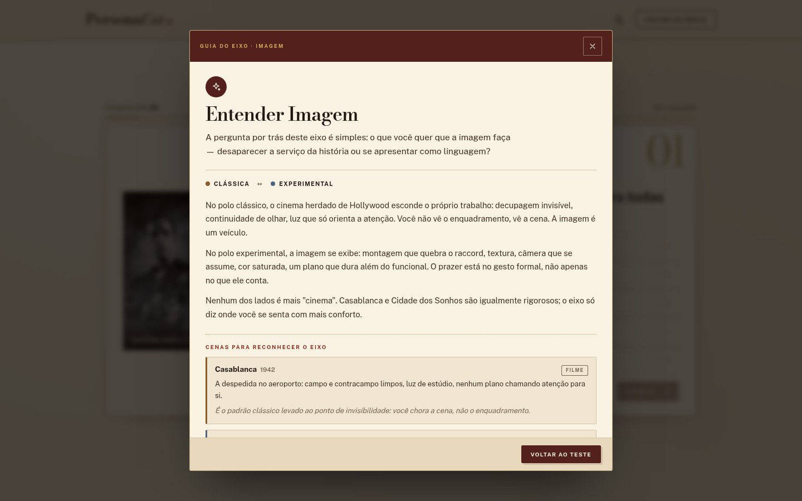
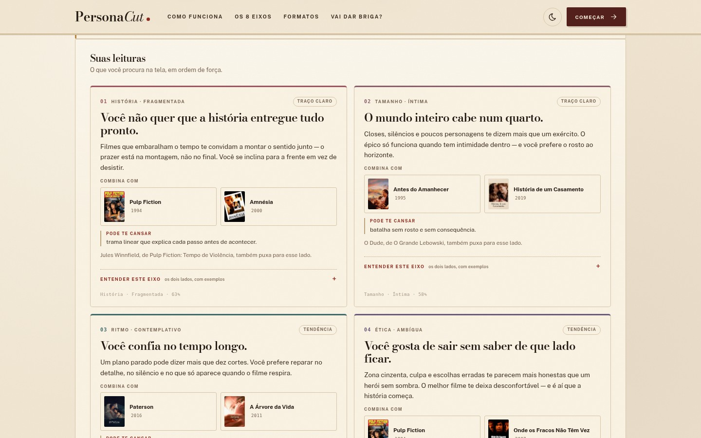
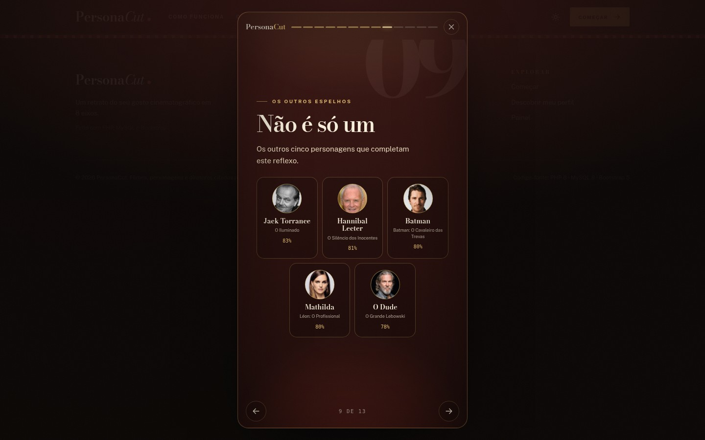
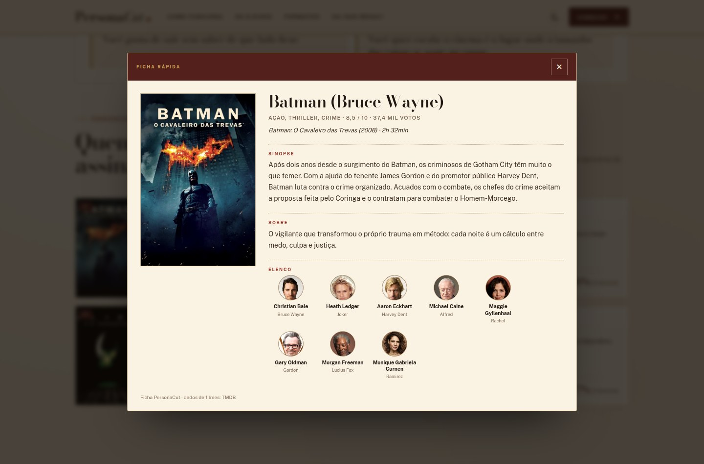
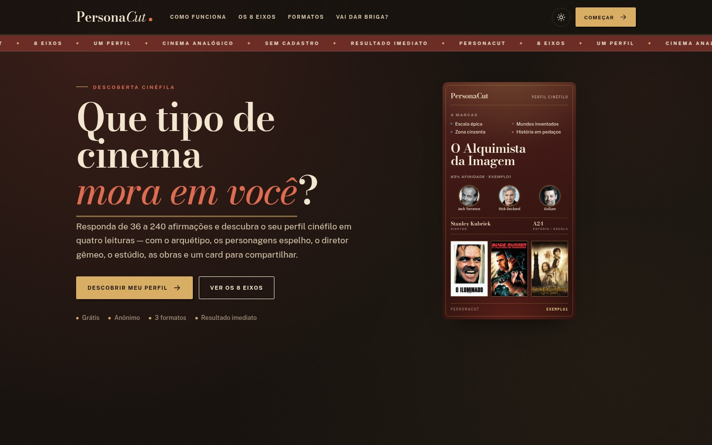

<div align="center">
  

  <h1>PersonaCut</h1>

  <p><strong>Seu perfil cinéfilo em 6 eixos.</strong><br>
  Responda de 24 a 48 afirmações e receba um retrato do seu gosto: quatro leituras em
  linguagem clara, um arquétipo, 10 filmes com descobertas e um card 9:16 para os stories.</p>

  <p>
    
    
    
    
    
    
  </p>
</div>

> Projeto da disciplina **Desenvolvimento Web 2 (DW2)**. Back-end em PHP puro
> (Orientação a Objetos, PDO e prepared statements), banco MySQL, front-end em
> HTML/CSS/JS sem framework de SPA — e uma camada de IA opcional usada só para
> redigir o retrato do perfil.

---

## Sumário

- [O que é](#o-que-é)
- [Como funciona](#como-funciona)
- [O que é medido (e o que não é)](#o-que-é-medido-e-o-que-não-é)
- [Prints](#prints)
- [Funcionalidades](#funcionalidades)
- [Stack](#stack)
- [Rodando local](#rodando-local)
- [Catálogo e streaming](#catálogo-e-streaming)
- [Auditoria de segurança](#auditoria-de-segurança)
- [Testes](#testes)
- [Estrutura](#estrutura)
- [Deploy no InfinityFree](#deploy-no-infinityfree-sem-docker)
- [Documentação](#documentação)
- [Créditos](#créditos)

## O que é

O PersonaCut transforma gosto de cinema em dados. O visitante responde a um
questionário Likert de 5 pontos e o sistema posiciona o perfil em **oito eixos
bipolares**. A partir desse vetor, ele traduz o resultado em consequência: o que
você procura na tela, o que te afasta, e quais personagens, diretor e escola
compartilham a sua assinatura.

- **Sem cadastro.** O resultado vira um código público de 8 caracteres.
- **Determinístico.** Arquétipo, afinidade e raridade nunca dependem de IA; o
  modelo de linguagem só escreve o retrato (e pode ser desligado).
- **Completo no celular.** Quiz, resultado, retrospectiva e card 9:16.
- **Além de Hollywood.** Cards de doramas, cinema coreano, indiano, japonês,
  brasileiro e latino-americano escolhidos pelo perfil, não pela vitrine global.
- **Onde assistir.** Ranking de plataformas por afinidade real com o seu vetor
  (Netflix, Prime Video, Disney+, Max, MUBI, Crunchyroll e outras).
- **Projeto acadêmico.** Feito para apresentar em sala, mas com decisões de
  produto e de engenharia de um projeto real.

## Como funciona

1. **Questionário.** 24, 36 ou 48 afirmações, sempre equilibradas entre os 6
   eixos e entre os dois polos de cada eixo.
2. **Vetor de 6 eixos.** Cada resposta vale de `-2` a `+2` e é ponderada por
   direção e peso:
   `pct_dir = 50 + 50 · Σ(resposta · direção · peso) / (2 · Σpeso)`.
3. **Leituras.** Os eixos mais extremos viram textos em linguagem clara — o que
   você busca, o que te cansa e exemplos de filmes do seu próprio perfil.
4. **Resultado.** Arquétipo, 10 filmes (com os personagens desses filmes),
   diretores e escolas por filmografia, onde assistir, descobertas, retrato,
   retrospectiva em capítulos e card para compartilhar.

| # | Eixo | Polo esquerdo | Polo direito | O que mede |
| --- | --- | --- | --- | --- |
| 1 | **Estética** | Popular | Autoral | onde o filme circula: blockbuster vs. circuito de arte |
| 2 | **Tom** | Claro | Sombrio | registro afetivo: leveza vs. desconforto |
| 3 | **Mundo** | Real | Imaginário | grau de invenção do mundo |
| 4 | **Ritmo** | Calmo | Intenso | experiência da duração |
| 5 | **Escala** | Íntimo | Épico | escala do drama |
| 6 | **Amplitude** | Circunscrito | Omnívoro | o quanto você sai do familiar (país, época, gênero) |

Definições operacionais, base crítica e fórmula completa em
[docs/EIXOS.md](docs/EIXOS.md).

## O que é medido (e o que não é)

O quiz mede; o catálogo é curadoria. A interface foi ajustada para não confundir
as duas coisas:

- **Posição, não porcentagem**: os filmes aparecem como `top 2%` do seu perfil;
  diretores aparecem como `3º de 10`. O score composto não é "82% de afinidade".
- **Confiança por bootstrap**: reamostragens das respostas mostram o quanto a
  posição é estável. Perfis com poucas respostas por eixo recebem confiança
  baixa — e o sistema diz isso.
- **Corte adaptativo**: cada perfil recebe os seus melhores 20% do catálogo,
  em vez de um limiar fixo que deixava perfis extremos sem plataforma.
- **Descoberta, não vitrine**: 60% dos filmes vêm fora do cânone, com piso de
  qualidade e diversidade; um seletor "Clássicos · Misturado · Descobertas"
  deixa o usuário escolher o quanto quer sair do familiar.
- **Decisão de assinatura**: a seção de streaming calcula a cobertura conjunta
  dos seus 50 melhores títulos ("Netflix + MUBI cobrem 78%").
- **"Já vi" no navegador**: o usuário marca o que já viu e o card desaparece;
  a lista fica no localStorage, sem crescer o banco.

A auditoria completa, os números e o caminho para a calibração empírica estão em
[docs/CALIBRACAO.md](docs/CALIBRACAO.md).

## Prints

| Quiz em uma tela | Entender o eixo (modal) |
| --- | --- |
|  |  |

| Resultado | Suas leituras |
| --- | --- |
|  |  |

| Retrospectiva | Ficha de personagem |
| --- | --- |
|  |  |

| Além do óbvio | Modo Sinergia |
| --- | --- |
|  |  |

| Os 6 eixos | Três formatos de teste |
| --- | --- |
|  |  |

| Painel administrativo | Perguntas e mídia do quiz |
| --- | --- |
|  |  |

<p align="center">
  
  <br>
  <sub>Card 9:16 gerado no servidor e exportado em PNG 1080 × 1920 com <code>html2canvas</code>.</sub>
</p>

## Funcionalidades

**Quiz**
- Três profundidades (24, 36 e 48 perguntas) com cotas iguais por eixo e por polo.
- Cena do filme (TMDB), GIF ou clipe oficial do YouTube, com fachada de clique.
- Atalhos de teclado (1–5), avanço automático opcional, rascunho em `localStorage`.
- Layout de duas colunas no desktop que cabe na tela — sem rolar para responder.
- Modal **Entender este eixo** com explicação longa, os dois polos, cenas de
  filmes/séries e referências críticas.

**Resultado**
- Arquétipo (match do vetor completo), leituras, radar SVG próprio e
  raio-x dos 6 eixos.
- **10 filmes** escolhidos pelo perfil, com o personagem/intérprete de cada um,
  piso de qualidade e mistura de clássicos e descobertas.
- **Diretores e escolas por filmografia**: o vetor sai das obras, não de uma
  opinião editorial. Cada um mostra a posição no grupo (`3º de 10`), a margem e
  os eixos que explicam a proximidade.
- Ficha rápida por tipo (personagem, ator, diretor, escola e filme), com
  sinopse/elenco da TMDB e biografia do intérprete.
- Cards de filme com pôster em todas as citações (leituras, década e guia).
- **Arquétipo secundário** e a **década do repertório** com curiosidades e filmes-marco.
- **Onde assistir**: pódio de plataformas por relevância, exclusividade, acervo,
  variedade e preço, com justificativa, "melhor para cada trilha" e a **cobertura
  conjunta** ("Netflix + MUBI cobrem 78% dos seus 50 melhores").
- **Além de Hollywood**: até seis cards de curadoria (doramas, cinema coreano,
  indiano, japonês, chinês, brasileiro, francês, sul-europeu, latino-americano
  e África/Ásia Ocidental) com títulos do catálogo e onde assistir.
- **Elenco do seu repertório**: atores dos títulos mais próximos, ponderados
  pela posição no crédito e pela afinidade da obra.
- Retrospectiva em capítulos (estilo stories) com swipe, teclado e progresso,
  incluindo um capítulo "Onde o seu cinema mora".
- Card 9:16 (PNG 1080 × 1920) e modo Sinergia entre dois códigos.

**Admin**
- CRUD de eixos, perguntas (com cena ilustrativa), entidades, obras e arquétipos.
- Plataformas: preço editorial, data da conferência, ordem e quais entram no ranking.
- Dashboard com perfis reais, base total e arquétipos mais frequentes.

## Stack

| Camada | Tecnologia |
| --- | --- |
| Back-end | PHP 8.2 puro (POO, PSR-12, PDO com prepared statements) |
| Banco | MySQL 8.4 (`utf8mb4`) |
| Front-end | HTML + CSS próprio (design system "cinema analógico") + JS puro (Fetch) |
| Gráficos | Radar bipolar em SVG gerado no servidor (sem biblioteca) |
| Card | `html2canvas` vendorizado + Web Share API |
| IA (opcional) | Groq — narrativa por perfil: retrato, leituras, arquétipo, diretor e descobertas |
| Catálogo | TMDB (pôsteres, retratos, logos, elenco e cenas), sempre no servidor |
| Streaming | Disponibilidade do TMDB/JustWatch, ingerida offline para o MySQL |
| Ambiente | Docker + Compose (Apache, MySQL e phpMyAdmin) |

O design system fica em `public/assets/css/personacut.css`: tokens de cor,
Bodoni Moda para display, Public Sans para texto, grão de filme, vinheta e tema
escuro. Não há framework de componentes no front.

<p align="center">
  
  <br>
  <sub>A mesma interface no tema escuro, com preferência salva no navegador.</sub>
</p>

## Rodando local

Requisitos: Docker com Docker Compose.

```bash
cp .env.example .env
docker compose up -d --build
```

O banco é criado e populado na primeira subida (schema + seed + enriquecimento +
catálogo versionado em `sql/010_catalogo_seed.sql`). Se você já tinha um volume
antigo, use `docker compose down -v` antes.

A base sintética do índice de raridade não vem no seed (a versão antiga gerava
linhas correlacionadas). Gere-a depois da primeira subida, se quiser o selo:

```bash
docker compose exec app php bin/base_sintetica.php --recriar --total=600
```

Comandos de calibração e diagnóstico:

```bash
docker compose exec app php bin/analise_itens.php --minimo=5
docker compose exec app php bin/calibrar_entidades.php
```

| Serviço | Endereço |
| --- | --- |
| Aplicação | <http://localhost:8090> |
| Painel administrativo | <http://localhost:8090/admin/> |
| phpMyAdmin | <http://localhost:8091> |
| MySQL | `localhost:3308` |

| Acesso | Credenciais |
| --- | --- |
| Banco | `personacut` / `personacut123` / database `personacut` |
| Admin | `admin` / `admin123` |

Chaves opcionais (o site funciona sem elas, com fallbacks):

```bash
# Retrato e frase do perfil redigidos por IA
GROQ_API_KEY=
GROQ_MODEL=                      # padrão: qwen/qwen3.8-27b

# Pôsteres, retratos, logos e cenas do quiz
TMDB_API_KEY=
```

```bash
docker compose exec app php tests/run.php   # testes (não precisam de banco)
docker compose down                          # para os serviços (mantém o banco)
docker compose down -v                       # para e apaga o banco
```

## Catálogo e streaming

O catálogo é ingerido **offline** e vive no MySQL; o site publicado não faz
chamadas de rede para montar cards, trilhas ou ranking. Com o ambiente no ar:

```bash
# 1. piloto de uma trilha (rápido, sem disponibilidade)
docker compose exec app php bin/catalogo_sync.php --piloto

# 2. catálogo completo + disponibilidade (TMDB, ~30 min na primeira vez)
docker compose exec app php bin/catalogo_sync.php

# 3. elenco e direção dos títulos mais populares
docker compose exec app php bin/catalogo_sync.php --creditos

# 4. diagnóstico de cobertura por trilha e plataforma
docker compose exec app php bin/catalogo_status.php

# 5. snapshot para o deploy e pacote do InfinityFree
docker compose exec app php bin/catalogo_export.php
docker compose exec app php bin/deploy_pacote.php

# 6. o cache da TMDB guarda payloads grandes; limpe quando terminar
docker compose exec app php bin/cache_limpar.php --tudo
```

Para ampliar a base, edite `limite` em `config/recomendacao.php` (por trilha) e
repita os passos 2 a 5. Regras de gosto (gênero, país, idioma, década) também
ficam nesse arquivo; depois de alterá-las, rode
`php bin/catalogo_sync.php --recalcular` para refazer os vetores sem baixar nada.
A disponibilidade e os metadados são revalidados a cada 90 dias
(`--force` força agora), respeitando o limite de 6 meses da TMDB.

## Auditoria de segurança

Teste de intrusão feito em **18/11/2026** na instância local
(`http://127.0.0.1:8090`), pelo autor do projeto e restrito a esse alvo. Nenhum
host externo foi testado. O objetivo era duplo: encontrar problemas reais e
documentar o processo como parte da entrega da disciplina.

### Ferramentas

- **[HexStrike AI](https://github.com/0x4m4/hexstrike-ai)** como servidor MCP no
  OpenCode, orquestrando as ferramentas dentro de um container Kali isolado.
- **nmap** (portas/serviços/headers), **nikto** (misconfigurações),
  **nuclei** (CVEs, exposições, misconfig), **sqlmap** (SQL injection),
  **ffuf** (descoberta de conteúdo), **wafw00f** (WAF), **curl** (testes manuais
  de CSRF, XSS, SSRF, métodos e payloads).
- O alvo não foi alterado: só leitura. Resultados de teste criados no banco
  foram removidos ao final.

### Resultado

**5 achados — nenhum crítico, todos tratados.**

| # | Achado | Severidade | Status |
| --- | --- | --- | --- |
| 1 | Sem limite de requisições no quiz anônimo e no login admin | **Média** | Corrigido |
| 2 | Headers de segurança ausentes (CSP, `nosniff`, referrer, permissions, HSTS) | Baixa | Corrigido |
| 3 | Fingerprint exposto (`X-Powered-By` e versão do Apache) | Baixa | Corrigido |
| 4 | `PUT`/`DELETE`/`OPTIONS` respondendo 200 em vez de 405 | Baixa | Corrigido |
| 5 | PHP 8.2.35 desatualizado | Baixa | Documentado |

### O que foi corrigido

**1. Rate limiting (quiz e login).** Novo `src/Core/RateLimit.php`, em arquivo
(`storage/cache/ratelimit`, sem banco e sem dependência), aplicado em
`public/api/quiz.php` (12 envios/minuto por IP) e em `public/admin/auth.php`
(8 tentativas de login a cada 10 minutos por IP, zeradas no sucesso). Se o
diretório não for gravável, o limitador libera a requisição — nunca derruba o
site.

**2. Headers de segurança.** `public/.htaccess` passa a enviar CSP, `nosniff`,
`Referrer-Policy`, `X-Frame-Options`, `Permissions-Policy` e oculta o
`X-Powered-By`. A CSP exigiu duas limpezas no front: o script de tema saiu do
HTML inline e virou `assets/js/theme.js`, e os `onsubmit="confirm(...)"` do
admin viraram `data-confirm` com um listener em `app.js`. Também removi o bundle
morto `bootstrap.bundle.js` (327 KB por página) — ele usava `eval` e era o único
bloqueio da política `script-src 'self'`.

**3. Fingerprint.** No Docker, `docker/php-security.ini` (`expose_php=Off`) e
`docker/apache-security.conf` (`ServerTokens Prod`, `ServerSignature Off`,
`TraceEnable Off`). Em hospedagem compartilhada, o `Header unset X-Powered-By`
do `.htaccess` resolve a parte do PHP.

**4. Métodos HTTP.** `public/.htaccess` agora recusa qualquer método fora de
`GET`, `POST` e `HEAD` com `403`.

**5. PHP.** A imagem continua em 8.2 por compatibilidade com o seed e as
extensões; o `Dockerfile` documenta a atualização como próximo passo.

### Antes → depois

```diff
- Server: Apache/2.4.69 (Debian)
- X-Powered-By: PHP/8.2.35
- (sem CSP, sem nosniff, sem Referrer-Policy…)
- PUT / → 200      DELETE / → 200      OPTIONS / → 200
- nikto: 12 itens (headers ausentes, PHP desatualizado, métodos estranhos…)

+ Server: Apache
+ (sem X-Powered-By)
+ Content-Security-Policy: default-src 'self'; script-src 'self'; …
+ X-Content-Type-Options: nosniff
+ Referrer-Policy: strict-origin-when-cross-origin
+ PUT / → 403      DELETE / → 403      OPTIONS / → 403
+ nikto: 3 itens (HSTS*, falso positivo e página de login encontrada)
```

\* HSTS fica comentado no `.htaccess` até o site ser publicado em HTTPS.

### O que já estava certo

| Teste | Resultado |
| --- | --- |
| SQL injection em `resultado.php?codigo=` (sqlmap) | não injetável |
| XSS refletido em `codigo` e `sinergia.php` | payload não refletido |
| CSRF no `POST /api/quiz.php` | 403 sem token; 422 com payload inválido |
| SSRF em `api/imagem.php?u=` (localhost, metadata, `file://`) | 400 (allowlist) |
| `.git/`, `.env`, `config/`, `storage/`, `sql/` | 404 (docroot é `public/`) |
| Listagem de diretório | 403 |
| Cookie de sessão | `HttpOnly`, `SameSite=Lax`, `Secure` sob HTTPS |
| Nuclei (CVE, exposição, misconfig, login padrão, SSL) | 0 resultados |

O alerta do nikto sobre **phpAuction/CVE-2002-0995** é falso positivo: a página
de login responde igual (2742 bytes) para qualquer query string.

### Como reproduzir

```bash
# 1. servidor HexStrike (uma vez) — Dockerfile em docs/security/hexstrike.Dockerfile
git clone https://github.com/0x4m4/hexstrike-ai ~/tools/hexstrike-ai
cp docs/security/hexstrike.Dockerfile ~/tools/hexstrike-ai/Dockerfile
docker build -t hexstrike-ai:kali ~/tools/hexstrike-ai
docker run -d --name hexstrike --network host hexstrike-ai:kali

# 2. scans (via MCP no OpenCode ou direto no container)
docker exec hexstrike nmap -sT -sV -Pn -p 8090 --script http-headers 127.0.0.1
docker exec hexstrike nikto -h http://127.0.0.1:8090 -nointeractive
docker exec hexstrike sqlmap -u 'http://127.0.0.1:8090/resultado.php?codigo=ABCD1234' --batch

# 3. provas das correções
curl -sI http://127.0.0.1:8090/ | grep -iE 'content-security|x-powered|server'
for m in PUT DELETE OPTIONS; do curl -s -o /dev/null -w "$m %{http_code}\n" -X $m http://127.0.0.1:8090/; done
```

## Testes

```bash
docker compose exec app php tests/run.php
```

Micro-framework próprio (sem PHPUnit) em `tests/_assert.php`, com **90 testes**:
Likert, matcher, raridade, sinergia, mídia, radar, leituras, cotas dos modos,
guia dos eixos, cards de filme, décadas, retrato (separação frase/texto),
recomendação (vetor de obra, confiança, trilhas), ranking de plataformas,
cards de trilha, elenco e o limitador de requisições.

## Estrutura

```
.
├── public/                     # DocumentRoot (Apache aponta para cá)
│   ├── index.php               # landing
│   ├── quiz.php                # formatos + questionário
│   ├── resultado.php           # dashboard + retrospectiva + card
│   ├── sinergia.php            # comparação entre dois perfis
│   ├── api/                    # quiz, quickview, retrato, imagem (proxy TMDB)
│   ├── admin/                  # login e CRUDs
│   ├── partials/               # head, header, footer, card de filme
│   ├── assets/                 # css, js, fontes, imagens e vendor
│   └── .htaccess               # headers, métodos HTTP e dotfiles
├── src/
│   ├── Core/                   # Database, Session, Csrf, Http, RateLimit, Vetor, Radar
│   ├── Data/                   # eixos_guia.php, decadas.php
│   ├── Models/                 # Eixo, CatalogoObra, Plataforma, CatalogoPessoa, Resultado…
│   ├── Services/               # Likert, Matcher, Recomendacao, PlataformaRanking, Trilha, Elenco
│   ├── Controllers/            # QuizController, PerfilController
│   └── bootstrap.php
├── bin/                        # catalogo_sync/export, deploy_pacote, tmdb_sync, midia_autofill…
├── config/                     # app, database, midia, leituras, filmes_cards
├── docker/                     # configuração de segurança do Apache/PHP
├── lang/                       # pt-BR.json (pronto para en/es)
├── sql/                        # schema, seed, enriquecimento, cenas, migrations
├── tests/                      # micro-framework + testes
├── storage/                    # cache, logs, backups e rate limit (ignorados)
└── docs/                       # EIXOS.md, ARQUITETURA.md, CRONOGRAMA.md, prints
```

## Deploy no InfinityFree (sem Docker)

O pacote `deploy/infinityfree/` tem o necessário para hospedagem compartilhada
(PHP + MariaDB):

- `personacut.sql` — schema, seed e enriquecimento em `utf8mb4_unicode_ci`;
- `catalogo.sql` — snapshot do catálogo (obras, gêneros, países, elenco e
  disponibilidade), importado depois do schema;
- `htdocs/.htaccess` — encaminha a raiz para `public/` e bloqueia código,
  configuração e dotfiles;
- `config/env.example.php` — modelo do `config/env.php` (o `.env` do Docker não é
  lido pelo PHP);
- `README.md` — passo a passo de banco, upload e permissões.

O site precisa ficar na raiz do domínio/subdomínio, porque a aplicação usa URLs
absolutas (`/quiz.php`, `/assets/...`). O `.htaccess` de `public/` também vale
lá: headers, métodos e bloqueio de dotfiles continuam ativos.

## Documentação

- [docs/EIXOS.md](docs/EIXOS.md) — base crítica dos 6 eixos, fórmula e cotas.
- [docs/ARQUITETURA.md](docs/ARQUITETURA.md) — fluxo do quiz, cálculo, quick view,
  cards de filme, catálogo, IA e layout.
- [docs/RECOMENDACAO.md](docs/RECOMENDACAO.md) — vetor de obra, confiança,
  trilhas, ranking de plataformas, elenco e como ampliar a base.
- [docs/CALIBRACAO.md](docs/CALIBRACAO.md) — o que é medido, o que é editorial,
  a auditoria das métricas, posição/confiança e o caminho de calibração empírica.
- [docs/security/relatorio-2026-11-18.md](docs/security/relatorio-2026-11-18.md) —
  relatório completo da auditoria, com evidências e comandos de reprodução.
- [docs/CRONOGRAMA.md](docs/CRONOGRAMA.md) — planejamento da disciplina.
- [deploy/infinityfree/README.md](deploy/infinityfree/README.md) — deploy.

## Créditos

- Catálogo, pôsteres, elenco e cenas: [TMDB](https://www.themoviedb.org/). *This
  product uses the TMDB API but is not endorsed or certified by TMDB.*
- Disponibilidade de streaming: [JustWatch](https://www.justwatch.com/), via
  TMDB. Os preços são referência editorial, editáveis no painel.
- Fontes: Bodoni Moda e Public Sans (Google Fonts, licença aberta).
- Captura do card: [html2canvas](https://html2canvas.hertzen.com/).
- Ícones: SVG próprios em `src/Core/helpers.php`.
- Auditoria de segurança: HexStrike AI + nmap, nikto, nuclei, sqlmap, ffuf,
  wafw00f.
